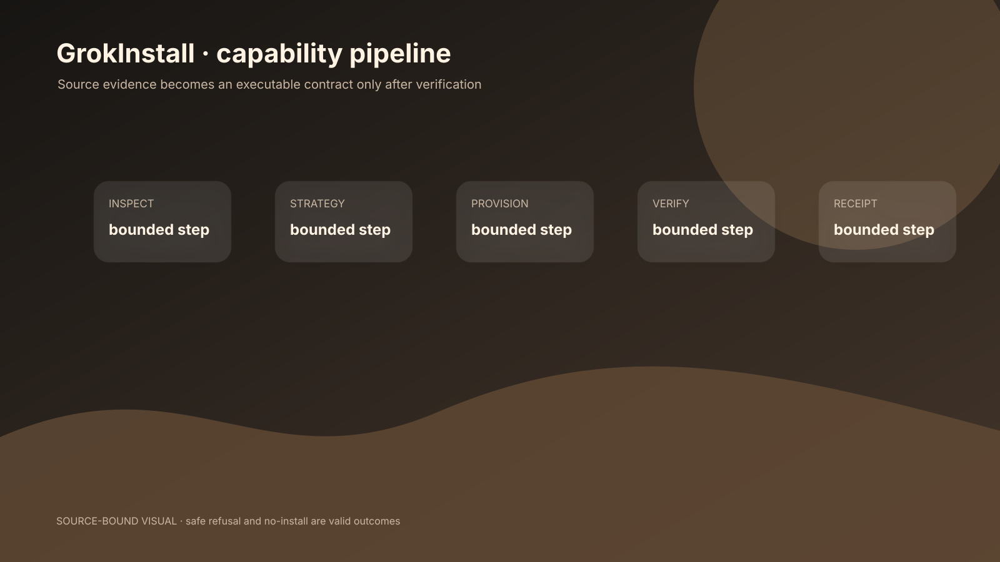
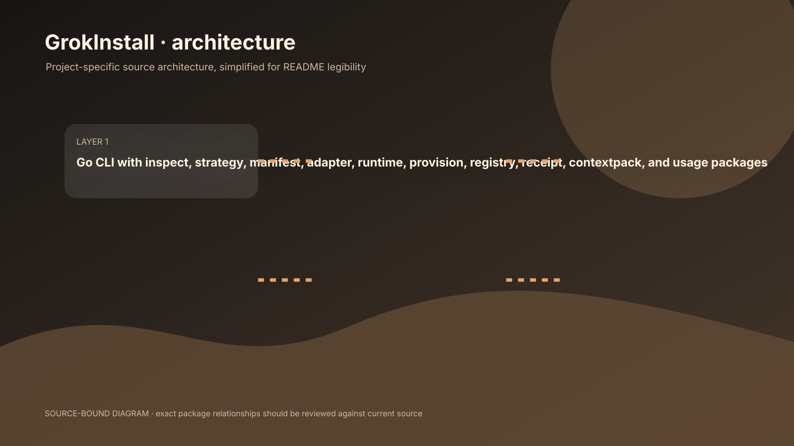

# GrokInstall

> Install the capability, not the complexity.

A Go CLI that inspects a source, compares integration strategies, provisions a bounded executable route, verifies it, registers a capability, and leaves a receipt.

[Documentation](docs/architecture.md) · [NOAERTH](https://www.noaerth.com)


## A repository-to-capability workflow

GrokInstall does not begin by running an installer. It inspects a source without executing its code, records evidence, compares integration strategies, plans a route, provisions only with explicit risk-specific approval, verifies the result, registers the capability, and leaves a receipt.



```text
source → inspect → evidence → strategy → plan → provision → adapter → runtime → verify → receipt
```

## Safety model

The runtime uses direct argv execution, reduced inherited environment, bounded output, process-group termination, input validation, and integrity checks for GrokInstall-owned runtimes. Archive traversal, unsafe paths, symlinks, oversized entries, decompression bombs, and secret-like content are treated as hazards. A failed verification does not register a capability.

## Real commands

```bash
`go install github.com/M4G3LL4N0/grokinstall/cmd/grokinstall@latest`
`grokinstall inspect https://github.com/sharkdp/bat`
`grokinstall plan https://github.com/sharkdp/bat --goal "Let GrokBot inspect text files"`
`grokinstall capabilities --json`
```

Other implemented command surfaces include `compare`, `install`, `grokbot`, `run`, `diagnose`, `audit`, and `uninstall`. Supported routes include `cli_bridge`, `knowledge_import`, `external_execution`, and `no_install`; several other strategies are compared but remain plan-only.

## Architecture

Go CLI with inspect, strategy, manifest, adapter, runtime, provision, registry, receipt, contextpack, and usage packages



The manifest is the executable contract. The adapter maps structured JSON to argv/stdin without shell interpolation. The registry owns lifecycle state, receipts preserve audit history, context packs bound model context, and usage records measured bytes and operation counts.

## Evidence and limits

| Evidence | Status |
|---|---|
| 30-second default runtime timeout | Source-backed; see `v4/VERIFIED_METRICS.json` for definition and status. |
| 1 MiB default output bound | Source-backed; see `v4/VERIFIED_METRICS.json` for definition and status. |
| 10 strategies × 12 qualitative dimensions (documented source fact) | Source-backed; see `v4/VERIFIED_METRICS.json` for definition and status. |

- Package-manager provisioning is classified but has no executor.
- Historical test counts require a current rerun.
- Artifact/capability names drift across historical docs.

Historical test totals and live acceptance claims must be labeled by commit until rerun against the current source. The tool does not claim universal support for arbitrary package managers or install scripts.

## Source map

- `internal/inspect/inspect.go`
- `internal/strategy/strategy.go`
- `internal/adapter/adapter.go`
- `internal/runtime/runtime.go`
- `internal/provision/provision.go`

## Status

Developer infrastructure in active development. Its distinctive promise is the safety pipeline and explicit refusal behavior, not frictionless automation at any cost.
